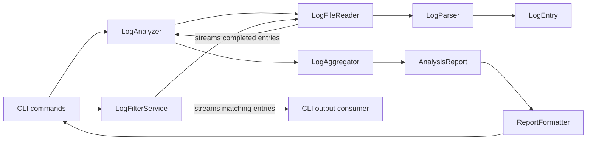

# Architecture

Log Analyzer is a small layered Java application. The CLI is an adapter over domain models and services; file discovery, parsing, aggregation, and filtering remain independent of terminal formatting.

## Package responsibilities

- `model`: `LogLevel` and immutable `LogEntry` values.
- `parser`: `LogParser`, which recognizes a single header line and returns an optional entry.
- `core`: `LogFileReader` handles recursive discovery and entry assembly; `LogAnalyzer` coordinates analytics; package-private `LogAggregator` maintains aggregate state; `LogFilterService` streams filtered entries; result records report file and filter counts.
- `filter`: `LogFilter`, the immutable set of optional matching criteria.
- `report`: `AnalysisReport`, an immutable snapshot of aggregate counts and rankings.
- `cli`: `Main`, `LogAnalyzerCli`, `CliCommandParser`, and `ReportFormatter` provide interactive/one-shot invocation, input parsing, command dispatch, and terminal rendering.

## Data flow: analysis

1. `LogAnalyzer.analyze(Path)` calls `LogFileReader.readDirectory` with the aggregator's `accept` method as the entry consumer.
2. `LogFileReader` recursively lists each directory, sorts its children by path, and considers regular files whose names end in lowercase `.log`.
3. Each file is opened as UTF-8 in a try-with-resources `BufferedReader` and read one line at a time.
4. `LogParser.parseHeader` attempts to parse each line. A valid header closes the previous event and begins a new one. Non-headers after the first event become continuation text; non-headers before the first event increment the malformed/orphan count.
5. At EOF, the reader emits the last accumulated event. The aggregator updates counters/maps and timestamp bounds, then creates an immutable `AnalysisReport` with file-reader totals.

Read failures for individual files are recorded as skipped and traversal continues. Directory traversal failures propagate as `IOException` to the CLI, which prints an error and remains in the command loop.

## Parsing and multiline behavior

The parser checks the fixed timestamp shape, exact spaces/delimiter, a single-token severity and logger name, then parses the date with strict resolution. Severity uses `LogLevel.fromString`. Invalid headers return empty rather than becoming entries.

The reader preserves header message text and appends each continuation line with `\n`. Any line after the first header that is not parsed as a valid header is continuation text, even if it resembles a malformed event. The starting path and line number always come from the header.

## Streaming and memory

The reader does not materialize a file's lines or a directory's entries. It retains the current event message until the next header/EOF and streams completed entries to its consumer. Directory discovery stores the immediate child paths of the current directory to sort them; it does not collect the full tree of files. The result retains skipped file paths as required by `DirectoryReadResult`.

The aggregator retains counters/maps proportional to the number of distinct logger names, source paths, exception names, and error hours, plus fixed severity counters. It never stores every `LogEntry`. The CLI filter command also passes matches directly from the reader to a formatting consumer.

## Aggregation

For each entry, the aggregator updates total/severity/logger/source counts and earliest/latest timestamps. ERROR and FATAL entries additionally update per-logger and hourly counters. Peak hour selects the highest hourly count; tied counts choose the earliest hour. Ranking maps are ordered by descending count and deterministic key order. Severity percentages use all valid entries, or zero when none were parsed.

Exception counts use a regular expression for qualified or simple Java-like identifiers ending in `Exception` or `Error`. Every matching occurrence is counted from the complete message, including continuation lines, regardless of severity. This intentionally does not attempt to parse the full Java exception grammar.

## Filtering

`LogFilterService.filter` invokes the reader for each request. It increments the examined count per emitted entry, applies all active criteria (AND), and sends matches immediately to the provided consumer. Severity and logger are exact matches; keyword is a case-insensitive substring of message text only; timestamp bounds are inclusive. No entries are cached between calls.

## CLI flow

`Main` runs the interactive loop when no arguments are supplied and supports one-shot command execution when arguments are supplied. `CliCommandParser` tokenizes quoted command input and parses filter options. `LogAnalyzerCli` validates command arguments, dispatches to `LogAnalyzer` or `LogFilterService`, and keeps the most recent successful report for `summary`, `errors`, and `top`. `ReportFormatter` renders those sections and each streamed filter result. Expected argument and I/O errors are printed without terminating the interactive loop.

## Design decisions and trade-offs

- The fixed format and standard JDK APIs keep parsing predictable and dependency-free.
- Local date/time is retained exactly as represented in the log because the format supplies no zone.
- One current message is buffered to assemble multiline events; exceptionally large events can therefore require substantial memory.
- Deterministic traversal/ranking improves repeatability, while ordering remains discovery order rather than global timestamp order.
- Filtering re-reads files to avoid retaining analysis entries or requiring a database/cache.
